  <picture>
    <source media="(prefers-reduced-motion: reduce)" srcset="./assets/monas-system-static.svg" />
    
  </picture>

  
<strong>Systems engineer &nbsp;·&nbsp; Applied AI &nbsp;·&nbsp; Security research</strong>

  

    <a href="https://monas.us">Website</a> &nbsp;·&nbsp;
    <a href="#selected-work">Selected work</a> &nbsp;·&nbsp;
    <a href="#what-im-exploring">Current focus</a>
  

## Hey, I'm Monas.

I build software where **systems engineering, AI agents, and security** meet. I'm interested in the parts that are harder to see: execution boundaries, protocols, state, failure recovery, and how a system knows what actually happened.

My approach is simple: **understand the behavior, find the first divergence, and build from evidence.**

Based in Vietnam · Independent engineering & research

## What I'm exploring

**EpisClaw** · Private R&D

An ongoing AI-agent runtime project focused on multi-channel interaction, scoped tools, long-running work, and durable execution. I'm exploring how to make agent systems more useful without losing track of permissions, state, or real-world outcomes.

Beyond agents, I spend time on protocol research, automation, local-first tooling, and security testing that measures **false positives as carefully as true positives**.

## Selected work

| Project | Focus |
| :--- | :--- |
| **[OpenClaw Memory](https://github.com/monasprox/openclaw-memory)** | A five-layer memory protection toolkit for OpenClaw agents, spanning observation, reflection, compaction and recovery. |
| **[Agent Security Intent Eval](https://github.com/monasprox/agent-security-intent-eval)** | A provider-agnostic evaluation harness for agent threat detection, including benign false-positive measurement. |
| **[Humanizer](https://github.com/monasprox/humanizer)** | A context-aware skill for more natural writing and Vietnamese conversation, grounded in role, intent and continuity. |

<strong>Other explorations and upstream forks</strong>

 

- [Zalo Personal](https://github.com/monasprox/zalo-personal): an upstream fork of the OpenClaw Zalo Personal integration.
- [Trafexia](https://github.com/monasprox/trafexia): an upstream fork of a mobile HTTP/HTTPS traffic inspection tool.
- [VoiceStudio](https://github.com/monasprox/VoiceStudio): an upstream fork of a local voice-production platform.

## Working stack

`Go` &nbsp; `Python` &nbsp; `TypeScript` &nbsp; `Bash` &nbsp; `Linux` &nbsp; `Docker` &nbsp; `PostgreSQL` &nbsp; `Redis`

These are tools I use or work with, not a scoreboard. The right choice depends on the system.

---

  
<em>Build for clarity. Verify the outcome.</em>

  <a href="https://monas.us">monas.us</a> &nbsp;·&nbsp; <a href="https://github.com/monasprox?tab=repositories">More repositories</a>

